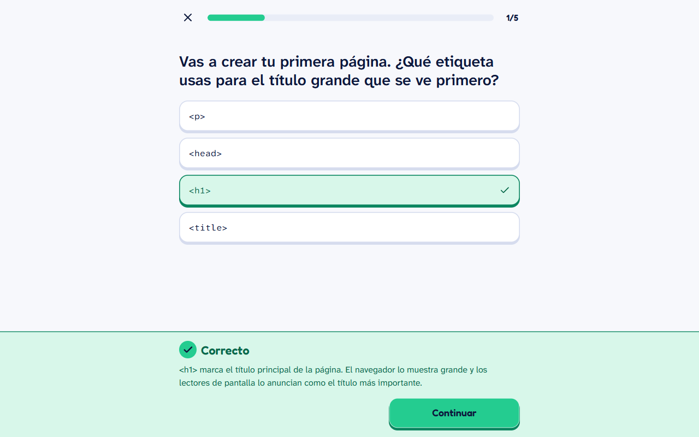
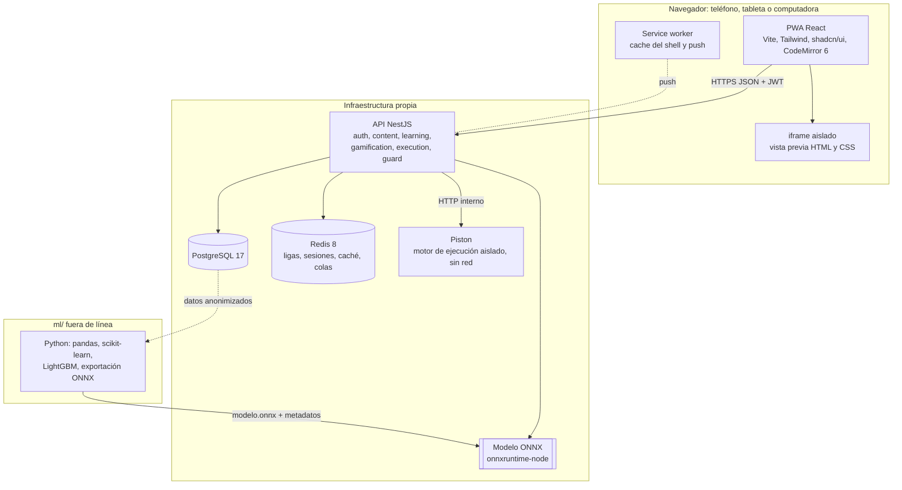
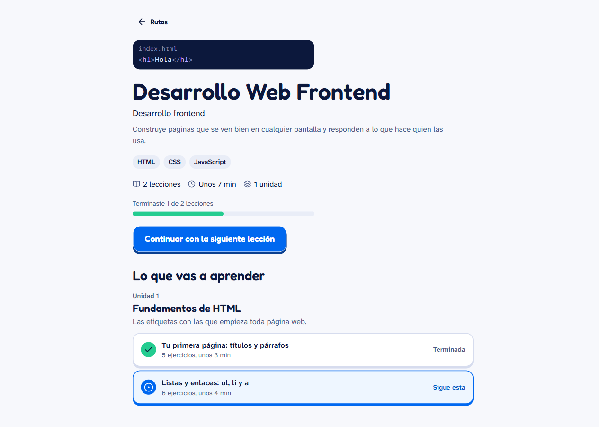
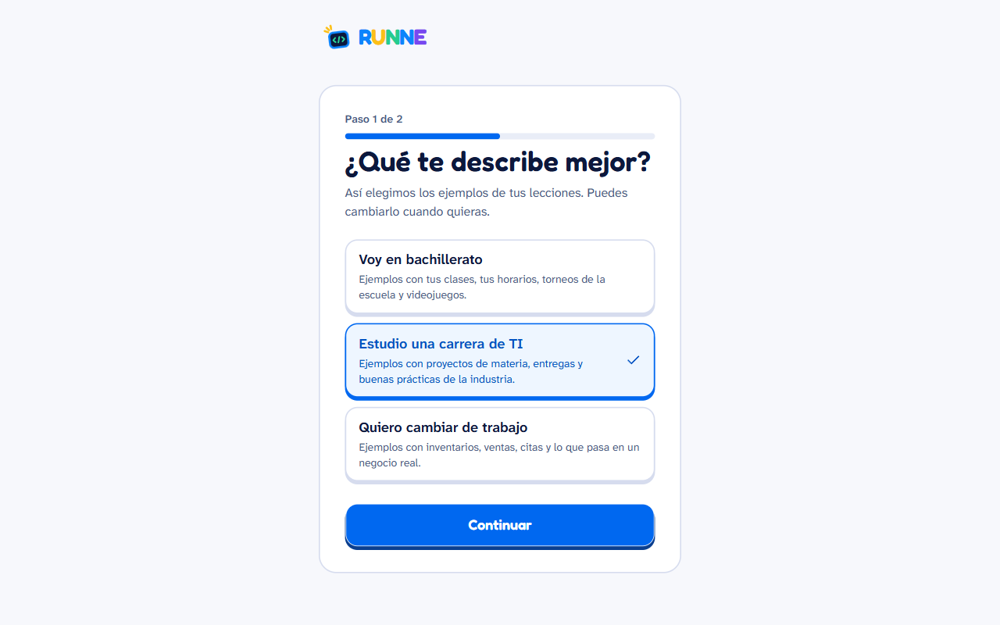
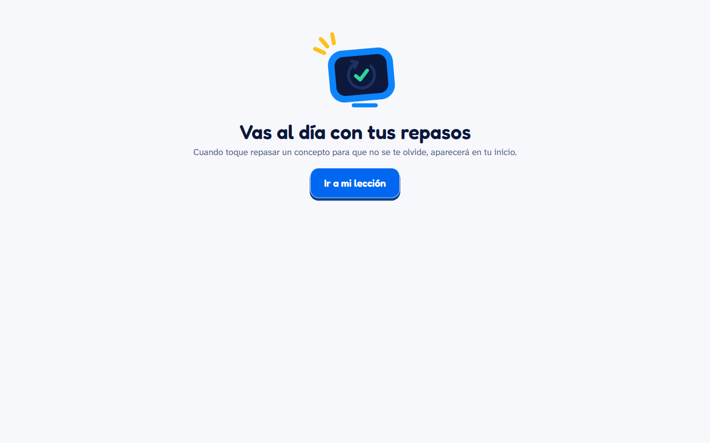
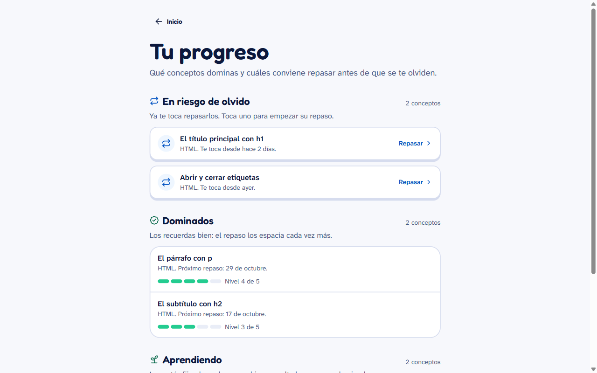
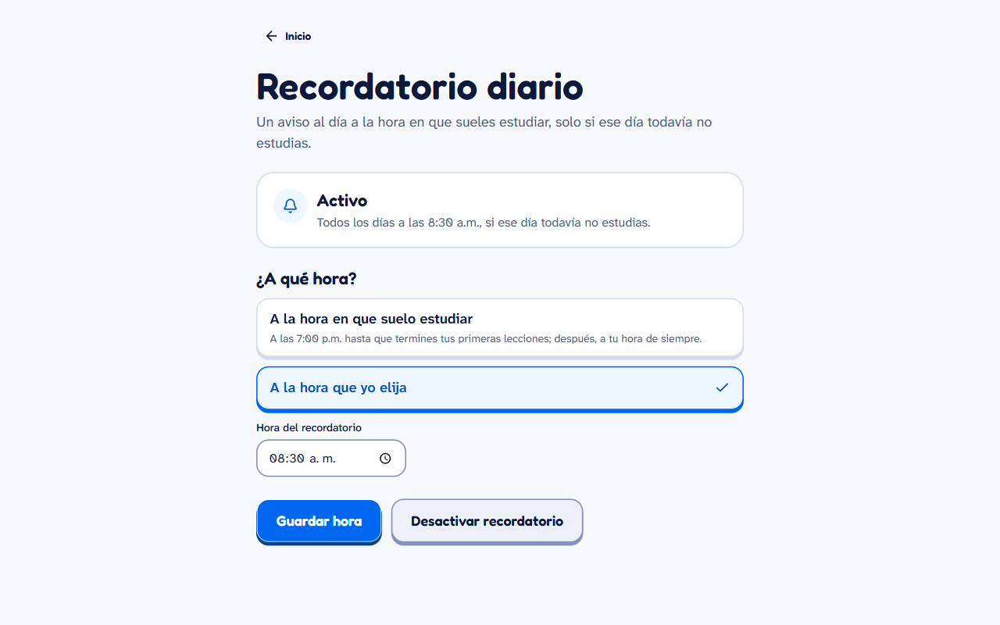
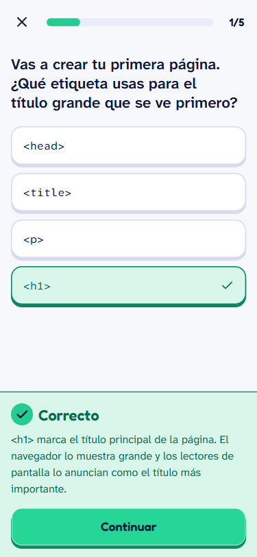

# Caso de estudio: RUNNE

**RUNNE** es una PWA gratuita, mobile-first y en español para aprender programación **cinco
minutos al día**: microlecciones, ejecución real de código, repasos con repetición espaciada y
**RUNNE Guard**, un modelo de machine learning que detecta al alumno que está por abandonar y
le adapta la siguiente sesión.

> Proyecto escolar de un equipo de seis personas (Grupo 701-V, UTN), desarrollado en 8 sprints
> entre el 28 de septiembre y el 15 de octubre de 2026. El código vive en el repositorio privado
> del equipo; aquí se documentan el proyecto y **mi parte**.

## El problema

Quien empieza a programar por su cuenta suele abandonar en las primeras semanas: lecciones
largas, entornos que no se instalan y errores en inglés que no entiende. RUNNE ataca las tres
cosas con lecciones de cinco minutos, código que se ejecuta en el navegador sin instalar nada,
errores explicados en español y un modelo que detecta el riesgo de abandono a tiempo.

## Qué hace

- **Registro en menos de un minuto** y onboarding por perfil que adapta tono y ejemplos.
- **Rutas por trayectoria profesional** y lecciones de cinco minutos con barra de avance.
- **8 formatos de ejercicio** resolubles con toques, pensados para el teléfono.
- **Ejecución real de código** (JavaScript, PHP, Java y SQL en un motor aislado; HTML y CSS en un
  iframe con `sandbox`) y **errores explicados en español** con la línea del alumno.
- **Repasos con SM-2** por concepto y vista de conceptos dominados y en riesgo de olvido.
- **Gamificación:** XP, racha con protector, vidas, insignias y liga semanal.
- **RUNNE Guard:** predicción al terminar la sesión y siguiente sesión adaptada; el alumno puede
  apagar la adaptación.
- **Recordatorio diario** por web push a la hora habitual.
- **CMS de contenido** y panel de administración de usuarios, roles y estado del motor.

## Arquitectura

- El motor de ejecución (Piston) escala aparte de la API y **no tiene red** para el código del alumno.
- RUNNE Guard corre dentro de la API; si falla o tarda más de 200 ms, se usa la dificultad estándar.

## Stack

| Capa | Tecnología |
|---|---|
| Monorepo | pnpm + Turborepo, contratos compartidos con zod |
| Web | React + Vite (PWA), Tailwind, shadcn/ui, CodeMirror 6 |
| API | NestJS, Prisma, PostgreSQL, Redis |
| Ejecución de código | Piston en Docker, sin red |
| Machine learning | Python (pandas, scikit-learn, LightGBM), inferencia con ONNX en Node |
| Calidad | Vitest, Playwright, pytest, k6, OWASP ZAP, Lighthouse, GitHub Actions |

## Cómo se trabajó

- **58 decisiones de arquitectura documentadas** (ADR), por ejemplo: Piston en lugar de Judge0,
  CodeMirror 6 en lugar de Monaco, SM-2 frente a FSRS, XP calculada en el servidor o pintar la
  primera pantalla antes del JavaScript.
- **20 historias de usuario** (155 puntos) repartidas en sprints; cada una con su rama, su PR, sus
  pruebas y sus capturas.
- **Integración continua** con lint, tipos, pruebas unitarias, de integración y E2E en cada PR.

## Resultados medidos (fase 4 de QA)

| Medición | Resultado |
|---|---|
| Pruebas | 179 en shared, 83 unitarias de la API, 135 de integración, 152 de la web, 112 E2E y 17 de Python, todas en verde |
| Cobertura de líneas | shared 94.0 %, API con integración 92.7 %, web 69.9 % |
| Lighthouse móvil | 16 pantallas con rendimiento de 90 a 100 y 100 en accesibilidad y buenas prácticas |
| Ejecución de código (P95) | Java 1.09 s; los demás lenguajes, menos de 0.3 s |
| RUNNE Guard bajo carga | P99 de 3 ms en la API |
| Carga (k6) | 51 inicios de sesión por segundo de techo; 60 personas en lecciones con P95 bajo 250 ms |
| Seguridad (OWASP ZAP) | 0 fallas en la web y en la API; ningún error 500 en unas 19,800 peticiones |

## Mi rol

Fui el **responsable del repositorio** e integré los PR del equipo. En el historial:

- **101 de los 142 commits** (sin contar fusiones) son míos, más **34 PR integrados**.
- **Historias de usuario que desarrollé:** registro (HU01), onboarding por perfil (HU02), rutas
  profesionales (HU03), lección de cinco minutos (HU04), los 8 formatos de ejercicio (HU11), repasos
  con SM-2 (HU07), progreso de conceptos (HU14), recordatorio por web push (HU15), recuperación de
  contraseña (HU19) y aviso de privacidad con consentimiento del tutor (HU20).
- **Fase 0:** monorepo, integración continua y entorno con Docker y el motor de ejecución.
- **Sprint 8 (estabilización y QA):** entorno de staging reproducible, pruebas de carga con k6,
  escaneo con OWASP ZAP, mediciones de Lighthouse y el ajuste del motor para Java (ADR-057).
- **Otros integrantes** desarrollaron, entre otras, RUNNE Guard y su ciclo de entrenamiento (HU08,
  HU17), el CMS (HU10), la gamificación y las ligas (HU09, HU12, HU13) y la administración (HU18).

## Capturas

| | |
|---|---|
|  |  |
|  |  |
|  |  |

---

## English summary

**RUNNE** is a free, mobile-first, Spanish-language PWA for learning to code five minutes a day:
micro-lessons, real code execution in an isolated engine, spaced repetition (SM-2), gamification
and **RUNNE Guard**, an ML model (LightGBM exported to ONNX) that predicts dropout risk and adapts
the next session. Built by a team of six in 8 sprints (school project) with a pnpm/Turborepo
monorepo, React + Vite, NestJS, Prisma, PostgreSQL, Redis and Piston. Measured results: over 670
automated tests, 92.7 % API coverage, Lighthouse mobile performance 90–100, zero ZAP findings.

**My role:** repository lead; 101 of 142 non-merge commits and 34 merged PRs. I built sign-up,
onboarding, career paths, lessons, the 8 exercise formats, SM-2 reviews, concept progress, web push
reminders, password recovery and minor consent, plus the Phase 0 setup and the Sprint 8 QA work
(staging, k6, ZAP, Lighthouse). RUNNE Guard, the CMS and gamification were built by teammates.
